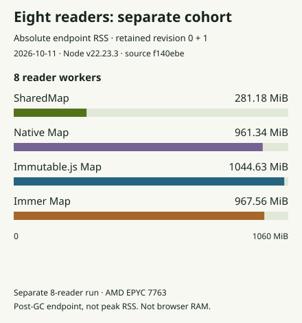

# SharedMap feature-map memory

This report measures string-keyed maps of road attribute objects. It uses the same records, keyed reads, sparse replacements and retained initial revision as the [live feature example](../website/content/maps.md). The [historical SharedList report](memory-comparison.md) measures log columns and remains unchanged.

## Results with reader workers

<!-- feature-memory:highlights:start -->

**84.7% less retained data with two reader workers.** SharedMap: 22.27 MiB; native Map: 145.39 MiB. This measure adds signed post-GC heap and tracked-buffer changes to unique shared backing capacity.

**46.7% lower process RSS in the same two-reader case.** SharedMap: 186.40 MiB; native Map: 349.68 MiB. This is absolute whole-process resident memory at the post-GC endpoint, without subtracting a startup baseline.

Both compare medians from three fresh trials with 100,000 road features, 100 replacements and initial/current revisions retained. Retained data and RSS use different accounting; they cannot be added or subtracted to explain the rest of the process. These are endpoint measurements, not peak memory.

<!-- feature-memory:highlights:end -->

## Whole-process RAM with two or four readers

<!-- feature-memory:rss -->


All four maps run the same workload at each reader count. The chart uses the `edited-retained` stage: 100,000 objects, 1,000 requested IDs including 90 misses, one 100-object replacement batch, and revision 0 plus current revision 1 retained in every owner and reader. RSS counts the whole Node process, including the owner, readers and runtime. The raw report also records process high-water RSS separately; the chart does not show that peak.

At four readers, SharedMap's median endpoint RSS is 215.45 MiB versus native Map's 551.53 MiB, 60.9% lower. This percentage compares the medians at the same reader count. Three fresh processes produce each median. Every sample and observed minimum–maximum range is in the downloadable data. These ranges are not confidence intervals.

The original-cohort savings chart includes two and four readers only. Two readers divide lookup and validation; four run two copies of those jobs. Zero-reader cases stay in the raw data as a method control. The owner performs both jobs in those cases. SharedMap's owner-only endpoint RSS is 158.19 MiB versus native Map's 143.25 MiB; the recording does not isolate the cause of that difference. No owner-only saving is claimed.

## Eight readers: a separate cohort

The eight-reader run uses the same workload and identical built library, adapter and comparison-library bytes. It ran separately on an AMD EPYC 7763 host; the original two/four-reader cases ran on an AMD EPYC 9V74 host. These are separate cohorts, not a controlled same-host scaling curve. Each chart compares libraries within its own cohort and labels its own zero-based scale.

<!-- feature-memory:rss-eight -->



With eight readers, SharedMap's median endpoint RSS is 281.18 MiB versus native Map's 961.34 MiB, 70.8% lower within this cohort. Three new trials per implementation produce 12 cases. Eight readers run four copies each of lookup and validation. No earlier case was rerun or pooled into these medians. Both original and new cohort data keep their own source commit, timestamps, runtime, host, raw cases and terminal receipt.

## Secondary component accounting

Retained data is the signed sum of post-GC JavaScript heap changes and tracked ArrayBuffer changes across all isolates, plus the current capacity of unique shared WASM backing stores counted once. The baseline consists of empty imported workers with connected MessageChannels. Each stage waits for work to finish and forces GC in every isolate.

Arena-used bytes are separate from full backing capacity and are not added twice. Different attachments can report earlier used prefixes for the same backing store; accounting uses the maximum prefix for each arena ID. Current capacity must agree. Caches, retained small answers, spare capacity and unreclaimed arena history are included. External memory remains a diagnostic. Negative component changes are preserved.

A separate calibration checks that this Node build counts ordinary ArrayBuffers but excludes shared WASM backing from `arrayBuffers`, including a worker attachment and memory growth. The run stops if that assumption fails.

## Equivalent work and history

Every path stores the same deeply frozen JSON-compatible records. SharedMap uses object `setMany`, Immutable.js uses Map batches, and Immer uses Map `produce` batches. Native Map copies its index only when current and retained initial are the same root, then mutates its exclusively owned current index. All paths replace objects without mutating retained values.

Each replica receives the initial dataset once. Later native, Immutable.js and Immer messages carry only 100 changed ID/object pairs. SharedMap messages carry descriptors for shared backing. No baseline is charged a full-dataset clone for sparse updates.

The proof records loaded data, first/repeat queries, one edit with retained history, released initial roots, and ten additional sparse edits. Current and retained answers must match the independent reference. Releasing a root does not reclaim individual shared-arena allocations; later stages expose that lifetime cost.

## Reproduce and inspect

The exact runtime source, Node/V8 versions, CPU, OS, architecture, timestamps, dependency versions and module hashes are in the downloadable data. These recordings used source/runtime commits `8ad5788648db93c18994fdde9b8fdb12e3a4957b` (0/2/4 readers) and `f140ebe650d536c9b88bd412c291a3cd91614454` (eight readers), whose measured runtime bytes matched. They predate the later main-branch optimizations, including PR30. The live example uses the current site build; these recorded figures do not measure that newer build or establish its gains.

```sh
node --test website/tests/feature-core.test.mjs proofs/feature-map-memory-checks.mjs
FEATURE_MEMORY_OUT=proofs/results/feature-map-memory/new-run \
node proofs/feature-map-memory.mjs
```

To record a new eight-reader-only cohort, set `FEATURE_MEMORY_READERS=8` and use another new output directory. The normal command measures the current checkout and records its provenance. The exact original-runtime check was specific to the preserved eight-reader validation run. Keep new cohorts separate; a different host or runtime is not a controlled extension of the earlier reader counts.

The documentation importer’s `--eight-readers` option is narrower: it requires the preserved `referenceRecording` and byte-identical original runtime to update this fixed supplemental chart. Ordinary fresh eight-reader outputs are standalone records and intentionally cannot replace this historical documentation cohort. Publishing a different cohort needs a new, explicitly reviewed comparison and its own provenance.

Use the [contributor setup](../CONTRIBUTING.md) and build the declared runtime before recording. The destination must be new or empty. Raw process output, calibration, source hashes, all stages, component samples and failures are retained. The [complete proof method](../proofs/feature-map-memory-method.md) describes the fixed 36-case matrix, accounting and limits.

The browser benchmark measures timings separately. These Node values do not measure the browser, the current device, or production application memory. Run the intended workload on the target device before choosing a design.
