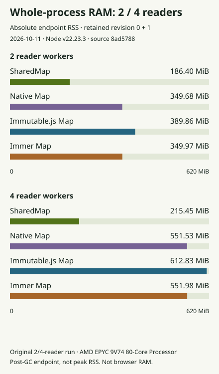

# SharedMap feature-map memory

This report measures string-keyed maps of road attribute objects. It uses the same records, keyed reads, sparse replacements and retained initial revision as the [live feature example](../website/content/maps.md). The [historical SharedList report](memory-comparison.md) measures log columns and remains unchanged.

## Retained map data

<!-- feature-memory:retained -->


The chart uses the `edited-retained` stage: 100,000 objects, 1,000 requested IDs including 90 missing IDs, one 100-object replacement batch, and revision 0 plus current revision 1 retained in every owner and reader. Three fresh processes produce each median. The data includes every sample and observed minimum–maximum range. These ranges are not confidence intervals.

## Reader scaling

<!-- feature-memory:readers -->


Only zero, two and four readers are measured. With zero readers the owner performs both jobs. Two readers divide lookup and validation. Four readers run two copies of those jobs, and all answers must agree with the reference. The zero-reader native Map is the single-owner control; there is no duplicate centralized result.

## Whole-process RAM

<!-- feature-memory:rss -->



RSS is absolute resident memory for the whole process, including worker and runtime overhead. It is not the retained-data total. The raw report also records process high-water RSS.

## What is counted

Retained data is the signed sum of post-GC JavaScript heap changes and tracked ArrayBuffer changes across all isolates, plus the current capacity of unique shared WASM backing stores counted once. The baseline consists of empty imported workers with connected MessageChannels. Each stage waits for work to finish and forces GC in every isolate.

Arena-used bytes are separate from full backing capacity and are not added twice. Different attachments can report earlier used prefixes for the same backing store; accounting uses the maximum prefix for each arena ID. Current capacity must agree. Caches, retained small answers, spare capacity and unreclaimed arena history are included. External memory remains a diagnostic. Negative component changes are preserved.

A separate calibration checks that this Node build counts ordinary ArrayBuffers but excludes shared WASM backing from `arrayBuffers`, including a worker attachment and memory growth. The run stops if that assumption fails.

## Equivalent work and history

Every path stores the same deeply frozen JSON-compatible records. SharedMap uses object `setMany`, Immutable.js uses Map batches, and Immer uses Map `produce` batches. Native Map copies its index only when current and retained initial are the same root, then mutates its exclusively owned current index. All paths replace objects without mutating retained values.

Each replica receives the initial dataset once. Later native, Immutable.js and Immer messages carry only 100 changed ID/object pairs. SharedMap messages carry descriptors for shared backing. No baseline is charged a full-dataset clone for sparse updates.

The proof records loaded data, first/repeat queries, one edit with retained history, released initial roots, and ten additional sparse edits. Current and retained answers must match the independent reference. Releasing a root does not reclaim individual shared-arena allocations; later stages expose that lifetime cost.

## Reproduce and inspect

The exact runtime source, Node/V8 versions, CPU, OS, architecture, timestamps, dependency versions and module hashes are in the downloadable data. This is current-main runtime evidence, with no optimization PR stacked. It establishes no causal gain for another revision.

```sh
node --test website/tests/feature-core.test.mjs proofs/feature-map-memory-checks.mjs
FEATURE_MEMORY_OUT=proofs/results/feature-map-memory/new-run \
node proofs/feature-map-memory.mjs
```

Use the [contributor setup](../CONTRIBUTING.md) and build the declared runtime before recording. The destination must be new or empty. Raw process output, calibration, source hashes, all stages, component samples and failures are retained. The [complete proof method](../proofs/feature-map-memory-method.md) describes the fixed 36-case matrix, accounting and limits.

The browser benchmark measures timings separately. These Node values do not measure the browser, the current device, or production application memory. Run the intended workload on the target device before choosing a design.
